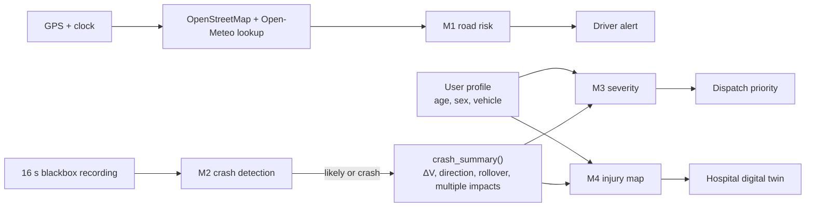

# Model spec

Everything you need to use the four SolveX models: what each one does, its inputs and outputs, its data, an example, and its scores and speed.

Weights: [huggingface.co/ZenoAbderrahim/solvex-crash-models](https://huggingface.co/ZenoAbderrahim/solvex-crash-models). Run `python download_models.py` to get them.

| | Model | Question it answers | When it runs | Output | Score |
|---|---|---|---|---|---|
| [M1](#m1) | Road risk | How risky is this road right now? | While driving | low, medium, high, very high | AUC 0.800 |
| [M2](#m2) | Crash detection | Did this car just crash? | After each device trigger | none, possible, likely, crash | AP 0.990 |
| [M3](#m3) | Injury severity | How badly is this person hurt? | After a detected crash | low, medium, high, extreme | AUC 0.889 |
| [M4](#m4) | Injury map | Which body regions are hurt? | After a detected crash | unlikely, check, likely, per region | mean AUC 0.827 |

**How they connect:**



**Speed at a glance** (one Intel i5-9300H laptop core, Python, measured with 300 runs):

| Step | Median | Model size |
|---|---|---|
| M1, one road segment | 2.2 ms | 1.2 MB |
| M1, 1,000 road segments | 11 ms | |
| M2, features + LightGBM + CNN-RNN | 4.4 ms | 2.7 MB + 1.2 MB |
| `crash_summary()` | 0.14 ms | |
| M3 | 0.46 ms | 0.3 MB |
| M4, all 7 regions | 3.2 ms | 1.5 MB |
| **Full crash chain: M2 → summary → M3 → M4** | **7.7 ms** | |

Loading each model takes under 40 ms. No GPU is needed to run any of them. M1's time doesn't include the OpenStreetMap and weather lookups, which depend on the network and aren't built yet.

---

<a id="m1"></a>

## M1 · Road risk

### 1. What it does

Scores how risky it is to drive on a road at a given moment, and warns the driver before they get there. It estimates risk **per passing car**, not raw accident counts, so a busy road at 17h isn't dangerous just because it's busy.

Model: LightGBM, 182 trees. Files: `m1/models/risk_model_nohist.txt` + `.json`. Runs on the phone or the server, with no blackbox needed.

### 2. Inputs (20)

The road codes are the **French BAAC codes** the model was trained on. They're categories, not quantities, and OpenStreetMap tags must be translated into them.

| Input | Type | Values | Source in Algeria |
|---|---|---|---|
| `catr` | category | road type: 1 motorway, 2 national, 3 departmental, 4 municipal, 5–9 other | OSM `highway` |
| `plan` | category | shape: 1 straight, 2 left curve, 3 right curve, 4 S-bend | OSM geometry |
| `vma` | number | speed limit, km/h | OSM `maxspeed` |
| `int` | category | intersection: 1 none, 2 X, 3 T, 6 roundabout, others | OSM junctions |
| `agg` | category | 1 outside town, 2 in town | OSM landuse or place |
| `circ` | category | 1 one-way, 2 two-way, 3 separated carriageways | OSM `oneway`, `dual_carriageway` |
| `nbv` | number | number of lanes | OSM `lanes` |
| `prof` | category | 1 flat, 2 slope, 3 hilltop, 4 bottom of hill | elevation data |
| `infra` | category | 0 none, 1 tunnel, 2 bridge, others | OSM `tunnel`, `bridge` |
| `hour` | number | 0–23 | clock |
| `weekday` | number | 0 Monday … 6 Sunday | clock |
| `month` | number | 1–12 | clock |
| `is_weekend` | 0/1 | Saturday or Sunday | clock |
| `is_dark` | 0/1 | sun is down | clock + GPS |
| `rain_mm` | number | rain this hour, mm | Open-Meteo |
| `rain_3h_mm` | number | rain over the last 3 hours, mm | Open-Meteo |
| `is_rain` | 0/1 | raining | Open-Meteo |
| `is_fog` | 0/1 | fog | Open-Meteo |
| `is_snow` | 0/1 | snow | Open-Meteo |
| `is_storm` | 0/1 | storm | Open-Meteo |

What the model relies on: speed limit 37%, road type 12%, lanes 10%, hour 7.5%, road shape 7%, two-way 6%, in town 5%.

### 3. Output

A raw probability `p`, which is **not** a real-world chance, because the training table has 1 accident per 4 normal moments. Convert it to "× riskier than average":

```
x = (p / (1 - p)) / (0.2 / 0.8)
```

| Level | Rule | App action |
|---|---|---|
| very high | x ≥ 3 | voice warning before entering the road |
| high | 1.5 ≤ x < 3 | visible warning |
| medium | 0.7 ≤ x < 1.5 | shown on the map only |
| low | x < 0.7 | nothing |

### 4. Data

French national road accident database (BAAC, ONISR), 2018–2024: 1.78 M rows, 20% accidents. Each accident is paired with about 4 "nothing happened" moments sampled like traffic (many at 17h, few at 3h). Trained on 2018–2022, tested on 2023–2024.

Kaggle: [training table with weather](https://www.kaggle.com/datasets/moussaballou/training-table-weather-csv) · [accidents 2016–2024](https://www.kaggle.com/datasets/moussaballou/accidents-2016-2024-csv).

### Example

**In:** national road, 90 km/h, two-way, T-junction, Sunday 23h in August, dark, dry.

```python
{"catr": 2, "plan": 1, "vma": 90, "int": 3, "agg": 1, "circ": 2, "nbv": 2, "prof": 1, "infra": 0,
 "hour": 23, "weekday": 6, "month": 8, "is_weekend": 1, "is_dark": 1,
 "rain_mm": 0, "rain_3h_mm": 0, "is_rain": 0, "is_fog": 0, "is_snow": 0, "is_storm": 0}
```

**Out:** `p = 0.160` → **0.76× average** → level **medium** (map only).

| Other situations (dry) | × average | Level |
|---|---|---|
| Rural curve, 80 km/h, Saturday 2h, dark | 6.5 | very high |
| City street, Friday 17h | 4.3 | very high |
| Same street, Tuesday 4h, dark | 2.8 | high |
| Motorway, 130 km/h, Wednesday 10h | 0.6 | low |
| Rural curve, 80 km/h, Tuesday 11h | 0.4 | low |

### 5. Metrics (test years 2023–2024)

| Version | AUC | Riskiest 10% of situations hold | Riskiest 20% hold |
|---|---|---|---|
| road + time | 0.799 | 31% of accidents | 51% |
| **road + time + weather (saved)** | **0.800** | **32%** | **52%** |
| + accident history (not available in Algeria) | 0.824 | 38% | 56% |

Warning only in the riskiest 10% of situations covers 3.2× more accidents than random.

### Known problems

- **Blank road fields make a road look much safer: fix before the demo.** A town street drops from 3.3× to 0.33× when its speed limit is missing. Fill gaps with defaults by road type (e.g. 50 km/h in town) before calling the model, or retrain.
- **Weather barely helps** (+0.001 AUC), and heavy rain scored lower than dry on one example. Don't demo rain.
- **The 0.800 is slightly optimistic:** the Kaggle run that produced this model used the test years to decide when to stop training. `m1/train_m1.ipynb` fixes that with a separate validation year, but hasn't been run yet.
- French roads and drivers, with traffic approximated by a typical daily curve. Our own crash reports can bring accident history back later.

---

<a id="m2"></a>

## M2 · Crash detection (blackbox)

### 1. What it does

Decides from a 16-second blackbox recording whether the car crashed. The device records a window whenever its g-force trigger fires; M2 then separates real crashes from hard braking, potholes, kerbs and near-misses.

Model: average of two models, LightGBM on 43 features and a small CNN-RNN (0.29 M parameters) on the raw signals. Files in `m2/models/`: `m2_lgbm.txt`, `m2_cnn.onnx` (or `.pt`), `m2_config.json`, `m2_blackbox.py`, `m2_sample_events.npz`.

Blackbox only. Phone-side detection isn't built yet.

### 2. Inputs

One 16 s window:

| Signal | Shape | Unit | Rate |
|---|---|---|---|
| Accelerometer | 1600 × 3 | g | 100 Hz |
| Gyroscope | 1600 × 3 | deg/s | 100 Hz |
| GPS speed | 16 | km/h | 1 Hz |

- **Axes:** x forward, y **left**, z up. The accelerometer reads +1 g on z at rest.
- Values are clipped to ±50 g, ±2000 deg/s and 0–300 km/h, and gyroscope values are rounded to 1 deg/s.
- `m2_blackbox.py` builds both model inputs: `window_features()` gives the 43 LightGBM features (`to_channels()` gives the CNN's 7 channels, which must be standardized with `ch_mean` and `ch_std` from the config).
- The ONNX model returns a **logit**: apply a sigmoid.

### 3. Output

`p_crash = (p_lightgbm + p_cnn) / 2`, then a level (cuts from `m2_config.json`):

| Level | Rule | Crashes caught | Non-crashes flagged | Precision on test | Platform action |
|---|---|---|---|---|---|
| crash | p ≥ 0.9585 | 72.3% | 0.10% | 99.4% | red alert, warn cars behind |
| likely | p ≥ 0.5726 | 95.0% | 0.93% | 95.6% | 30 s "Are you OK?", pre-alert dispatcher |
| possible | p ≥ 0.0886 | 99.2% | 3.9% | 84.3% | quietly ask driver and witnesses |
| none | below | | | | log only |

Each row counts that level and above. For `likely` or `crash`, also call `crash_summary()`.

**`crash_summary()`** computes the blackbox inputs for M3 and M4 from the same window:

| Field | Meaning |
|---|---|
| `dv_kmh` | speed change over the crash pulse, km/h |
| `pdof_deg` | where the force comes from, clockwise from the front: 0 front, 90 right, 180 rear, 270 left (driver's door in Algeria). Same convention as NASS and CISS. |
| `rollover` | 1 if the car rolled past 90° or ended upside down |
| `multi_impact` | 1 if a second x-y peak over 1.5 g comes at least 0.5 s from the main one |
| `peak_g`, `speed_before_kmh` | for the incident card and the police report |

### 4. Data

[VZCrash](https://huggingface.co/datasets/vzc-research-chapter/VZCrash) (2026, CC BY-NC 4.0): 189,303 real recordings from devices fixed in 73,010 commercial vehicles, labeled by 3 experts with dashcam video. 31,079 crashes; near-misses and normal driving (including potholes and kerbs) count as no crash. Split by vehicle: train 137,954, validation 27,175, test 24,174.

### Example

Real test recording, event 1750470: car at 54 km/h, 5.2 g peak.

```python
p_crash = 0.999, level = "crash"
crash_summary = {"dv_kmh": 8.5, "pdof_deg": 273, "rollover": 1, "multi_impact": 1,
                 "peak_g": 5.16, "speed_before_kmh": 54.0}
```

The force comes from the left, at the driver's door. Across the 24 saved sample events, all 8 crashes scored 0.92–0.999, all 8 normal drives 0.00, and 7 of 8 near-misses under 0.01; one near-miss scored 0.91 and would reach "likely". That is what the 30 s check-in is for.

### 5. Metrics (test set)

| Model | AP | ROC AUC | Recall @ 95% precision | Recall @ 99% precision |
|---|---|---|---|---|
| Rule: ΔV ≥ 8 km/h in 150 ms (airbag-module style) | 0.843 | 0.956 | 52.0% | 0% |
| Rule: peak g-force (paper baseline) | 0.896 | 0.979 | 35.6% | 0% |
| LightGBM | 0.983 | 0.996 | 90.4% | 71.1% |
| CNN-RNN | 0.990 | 0.998 | 95.6% | 76.0% |
| **Ensemble (deployed)** | **0.990** | **0.998** | **95.7%** | **80.7%** |

- Our peak-g rule scores exactly the paper's 0.896, which validates the data pipeline. The paper's best model scored 0.976 (mean of 3 runs); ours is one run.
- AP by vehicle: light 0.992, medium 0.992, heavy 0.986.
- The fixed 8 km/h rule catches only 51% of crashes (0.6% false alarms), because most crashes here are low-speed contacts.
- **False alarms:** at 75% of crashes caught, the rule gives 2,596 per 100,000 test events and the ensemble 125, about 20× fewer. On real roads only about 1 triggered event in 5,000 is a crash, and the paper measured the same rule at 106 per 100,000 there. Scaled the same way, ours would be roughly 5 per 100,000. That's an estimate, not a measurement.
- **Training:** about 10 min on a Kaggle T4: 3 min loading, 1 min LightGBM, 20 epochs × 16 s for the CNN-RNN.
- The downloaded weights reproduce the Kaggle scores on all 24 sample events to within 0.0001.

### Known problems

- **`crash_summary()` can underestimate ΔV.** One real crash with a 3.4 g peak at 79 km/h came out at ΔV 0.3 km/h. Oscillating pulses seem to cancel out in the integration, or the pulse window misses them. A low ΔV sends M3 too low, so fix this first.
- **`multi_impact` fires on 46% of detected crashes**, which is too high. The 1.5 g threshold probably counts rebounds. It's M3's third input.
- Commercial vehicles and mostly minor crashes (median ΔV 8.3 km/h). Recalibrate on our own blackbox data.

---

<a id="m3"></a>

## M3 · Injury severity

### 1. What it does

Estimates the chance that **the person** (not the car) is seriously injured, and turns it into a dispatch priority. It uses no car sensors: no belt, no airbag.

Model: LightGBM, 176 trees. Risk can never go down when ΔV goes up (monotone constraint). Files: `m3/models/m3_lgbm.joblib` + `m3_config.json`.

### 2. Inputs (10)

| Input | Type | Meaning | Source | Share of decisions |
|---|---|---|---|---|
| `dv_kmh` | number | speed change during impact, km/h | `crash_summary()` | 65.8% |
| `age` | number | years | profile | 13.4% |
| `pdof_sin`, `pdof_cos` | number | sin and cos of `pdof_deg` | `crash_summary()` | 9.6% |
| `multi_impact` | 0/1 | more than one impact | `crash_summary()` | 6.6% |
| `rollover` | 0/1 | car rolled over | `crash_summary()` | 2.8% |
| `body_utility`, `body_van`, `body_pickup` | 0/1 | SUV, van or pickup; all 0 = car | blackbox pairing | 1.1% |
| `male` | 0/1 | 1 male, 0 female | profile | 0.6% |

Pass them in the order given by `features` in `m3_config.json`. No BMI: its missing values leaked the answer, so it was removed.

### 3. Output

`P(MAIS 3+)`: the chance of a serious injury. Read it as a ranking rather than a real-world probability, because investigated crashes over-represent serious ones. Then:

| Level | Rule | Meaning |
|---|---|---|
| extreme | p ≥ 50% | more likely seriously injured than not |
| high | p ≥ 3.56% | line that catches 90% of serious cases |
| medium | p ≥ 2.17% | line that catches 95% |
| low | below | very unlikely to be serious |

**Rule outside the model (not implemented yet):** pregnancy, heart disease or blood thinners raise the level by one.

### 4. Data

NHTSA NASS-CDS 2010–15 + CISS 2017–23, public US crash investigations: 59,844 occupants, of which 29,945 (15,826 crashes) have ΔV, direction, age and sex. 8.7% seriously injured (2.2% in the real US population). Split 64/16/20 by crash, so people from the same car are never in both train and test.

### Example

**In:** RN5, car hits the guardrail, two impacts, 45-year-old man.

```python
{"dv_kmh": 55, "pdof_sin": 0.174, "pdof_cos": 0.985, "rollover": 0, "multi_impact": 1,
 "age": 45, "male": 1, "body_utility": 0, "body_van": 0, "body_pickup": 0}
```

**Out:** `p = 0.435` → level **high** → ambulance prioritized.

| Other crashes | Chance | Level |
|---|---|---|
| Parking bump, rear, ΔV 8, man 30 | 0.3% | low |
| City crash, front, ΔV 25, woman 25 | 2.6% | medium |
| Driver's door hit, ΔV 35, man 68 | 40.5% | high |
| Highway rollover, ΔV 40, woman 40 | 47.4% | high |

### 5. Metrics (test set)

| Model | AUC | AUC (US-weighted) | Over-triage @ 90% catch | @ 95% catch |
|---|---|---|---|---|
| ΔV only | 0.837 | 0.808 | 51.2% | 74.3% |
| Logistic regression, same inputs (OnStar-style) | 0.884 | 0.901 | 32.5% | 42.6% |
| **Our model (saved)** | **0.889** | **0.898** | **31.2%** | **40.1%** |
| + seatbelt, on people with known belt use | 0.897 | 0.896 | 29.1% | 39.4% |

Over-triage = share of not-serious people flagged when the alarm is set to catch 90% (or 95%) of serious ones.

- Seriously injured predicted high or extreme: **94.8%**
- Seriously injured predicted low (the dangerous miss): **1.6%**
- Not-serious predicted high or extreme (extra ambulances): **39.6%**
- The seatbelt sensor adds +0.014 AUC on the same people.

| Real injury \ predicted | low | medium | high | extreme |
|---|---|---|---|---|
| low | 47.9% | 16.0% | 35.4% | 0.8% |
| medium | 18.7% | 11.1% | 65.6% | 4.5% |
| high | 2.7% | 4.0% | 77.7% | 15.7% |
| extreme | 0.0% | 3.2% | 56.9% | 39.8% |

### Known problems

- **ΔV comes from a different source in training.** Here it's from crash reconstruction; in the app it comes from `crash_summary()`. Nobody has compared the two yet.
- **No profile, no age.** Every training row had age and sex, so behaviour without them is untested. Use a default adult and flag the result.
- US cars and occupants.
- The `.joblib` file needs `scikit-learn==1.5.2` and `lightgbm==4.5.0`.

---

<a id="m4"></a>

## M4 · Injury map

### 1. What it does

Predicts which body regions are injured, for the hospital's digital twin. Kept separate from M3 so a weaker body map can never affect dispatch.

Model: 7 LightGBM models, one per region. Files: `m4/models/m4_lgbm.joblib` (a dict of region → model) + `m4_config.json`.

### 2. Inputs (10)

The same as [M3](#m3), in the order given by `features` in `m4_config.json`. Seat position was tested and adds nothing, so the app doesn't need to ask "are you driving?".

### 3. Output

For each region, the chance of an AIS 2+ injury (moderate or worse), then a state:

| Region | `check` from | `likely` from | Test AUC |
|---|---|---|---|
| abdomen | 3.7% | 13.4% | 0.879 |
| thorax | 6.8% | 42.1% | 0.867 |
| legs | 5.5% | 39.7% | 0.856 |
| face | 1.2% | 50% | 0.824 |
| spine (neck included) | 4.0% | 50% | 0.816 |
| arms | 3.4% | 37.6% | 0.775 |
| head | 4.1% | 50% | 0.774 |

- **likely:** at least half of the people marked here are really injured there. Reached for thorax, abdomen and legs; arms rarely. Face, spine and head stop at 50% because they never get that precise.
- **check:** the region to examine. Catches about 75–87% of injuries.
- **unlikely:** below that.

Show it as **"where to look first"**, not as a diagnosis.

### 4. Data

NHTSA CISS 2017–23: 18,297 occupants with ΔV, direction, age and sex. CISS only, because its injury tables give the body region of every injury. Each injury's AIS code gives its region.

### Example

**In:** the same RN5 crash as M3.

**Out:**

| Region | Chance | State |
|---|---|---|
| legs | 37.0% | check |
| thorax | 34.0% | check |
| head | 20.7% | check |
| arms | 19.5% | check |
| spine | 17.2% | check |
| abdomen | 8.9% | check |
| face | 7.2% | check |

In a severe crash most regions reach "check", so **sort by chance** and show the top few. Here that means legs and thorax first, which fits a frontal hit.

### 5. Metrics (test set)

| Model | Mean AUC | Top-2 hit |
|---|---|---|
| Rules from the papers | 0.761 | 62% |
| Logistic regression | 0.821 | 68% |
| **Our model (saved)** | **0.827** | **65%** |
| + seat position | 0.827 | |

Top-2 hit: for injured people, one of the two highest-ranked regions is really injured. Random: 46%. Our model and the formula are equal within the noise of the split (about ±0.01).

### Known problems

- Head injuries matter most and are the hardest to predict (AUC 0.77). The ambulance crew's assessment overrides the map.
- A logistic regression does about as well, so it's a simple fallback.
- Same ΔV source issue and version pins as M3.

---

## Using the models

```bash
pip install -r requirements.txt
python download_models.py
```

```python
import json, sys
import numpy as np, pandas as pd, lightgbm as lgb, joblib, onnxruntime as ort
sys.path.insert(0, "m2")
import m2_blackbox as bb

# --- M1: road risk. Categories must use the model's own category lists.
m1 = lgb.Booster(model_file="m1/models/risk_model_nohist.txt")
c1 = json.load(open("m1/models/risk_model_nohist.json"))
road = {"catr": 2, "plan": 1, "vma": 90, "int": 3, "agg": 1, "circ": 2, "nbv": 2, "prof": 1, "infra": 0,
        "hour": 23, "weekday": 6, "month": 8, "is_weekend": 1, "is_dark": 1,
        "rain_mm": 0, "rain_3h_mm": 0, "is_rain": 0, "is_fog": 0, "is_snow": 0, "is_storm": 0}
x = pd.DataFrame([road])[c1["features"]].astype(float)
for col, cats in zip(c1["categorical"], m1.pandas_categorical):
    x[col] = pd.Categorical(x[col], categories=cats)
p = m1.predict(x)[0]
b = c1["base_rate"]
print("M1:", round((p / (1 - p)) / (b / (1 - b)), 2), "x average")

# --- M2: crash detection, on a real saved recording.
lg = lgb.Booster(model_file="m2/models/m2_lgbm.txt")
cnn = ort.InferenceSession("m2/models/m2_cnn.onnx")
c2 = json.load(open("m2/models/m2_config.json"))
events = np.load("m2/models/m2_sample_events.npz", allow_pickle=True)
c = events["channels"][0].astype(np.float32)                  # 7 x 1600
acc, gyro, speed = np.stack([c[0], c[1], c[2] + 1], 1), c[3:6].T, c[6, ::100]

_, X = bb.window_features(acc[None], gyro[None], speed[None])
p_lgbm = lg.predict(pd.DataFrame(X, columns=c2["features"]))[0]
ch = bb.to_channels(acc[None], gyro[None], speed[None])
mean, std = (np.array(c2[k], np.float32)[None, :, None] for k in ("ch_mean", "ch_std"))
logit = cnn.run(None, {"x": (ch - mean) / std})[0][0]
p_crash = (p_lgbm + 1 / (1 + np.exp(-logit))) / 2
cuts = c2["cuts"]
level = next((k for k in ("crash", "likely", "possible") if p_crash >= cuts[k]), "none")
print("M2:", round(float(p_crash), 3), level)

# --- crash_summary + profile -> M3 and M4.
s = bb.crash_summary(acc, gyro, speed)
a = np.radians(s["pdof_deg"])
c3 = json.load(open("m3/models/m3_config.json"))
row = {"dv_kmh": s["dv_kmh"], "pdof_sin": np.sin(a), "pdof_cos": np.cos(a), "rollover": s["rollover"],
       "multi_impact": s["multi_impact"], "age": 45, "male": 1,
       "body_utility": 0, "body_van": 0, "body_pickup": 0}
x = pd.DataFrame([row])[c3["features"]].astype(float)
p3 = joblib.load("m3/models/m3_lgbm.joblib").predict_proba(x)[0, 1]
t = c3["thresholds"]
print("M3:", round(float(p3), 3),
      "extreme" if p3 >= t["extreme"] else "high" if p3 >= t["high"] else "medium" if p3 >= t["medium"] else "low")

c4 = json.load(open("m4/models/m4_config.json"))
m4 = joblib.load("m4/models/m4_lgbm.joblib")
chances = {r: float(m.predict_proba(x[c4["features"]])[0, 1]) for r, m in m4.items()}
print("M4:", {r: round(v, 3) for r, v in sorted(chances.items(), key=lambda kv: -kv[1])})
```

**Things that break silently:**
- M1: pass categories with the model's own lists, as above.
- M2: the y axis points **left**. A device with y pointing right flips every side impact.
- M2: the ONNX model expects standardized channels and returns a logit.
- M3 and M4: the direction goes in as sin and cos of degrees, never as raw degrees.
- Read thresholds from the JSON configs instead of hard-coding them.

**License:** M2 is trained on VZCrash (CC BY-NC 4.0), so the weights are non-commercial. Any paid product needs its own data or a license for it.
