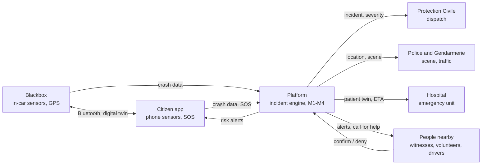

# SolveX 3.0 · Crash response project

Problématique 1: road accidents. Our concept, the Algerian context, what we're building, the AI models and suggestions. Model details are in [MODEL_SPEC.md](MODEL_SPEC.md); how to run things is in [README.md](README.md).

1. **Accident** GPS from phone + blackbox
2. **Alert** app, people nearby, SMS
3. **Evaluation** M2–M4 + caller answers
4. **Orientation** right hospital: missing [S2](#s2)

M1–M4 are the AI models. S1–S14 link to the [suggestions](#suggestions).

<a id="first"></a>

## Read this first

- The brief asks for **vital signs** and for **sending the patient to a suitable facility**. Our plan has neither yet. [S2](#s2)
- Time is short for 4 models, 4 apps and a simulator. Write the demo story first and build only what it shows. [S1](#s1)
- **M2 (blackbox) is trained:** AP 0.990 on 24,000 real recordings from vehicles it never saw, against 0.896 for the physics rule. At the same catch rate it raises about 20× fewer false alarms than the rule. [M2](MODEL_SPEC.md#m2)
- **M1, M3 and M4 are trained too.** M1 scores AUC 0.80 on two years it never saw, but has a missing-data flaw to fix. M3 scores AUC 0.89 without belt or airbag data. M4 is reliable for thorax, abdomen and legs, weaker for head and arms. [M1](MODEL_SPEC.md#m1) · [M3](MODEL_SPEC.md#m3) · [M4](MODEL_SPEC.md#m4)
- The blackbox needs one sensor the phone can't replace: a **high-g accelerometer bolted to the car**. It gives ΔV and impact direction, which drive 75% of M3's decisions. M1 needs no blackbox sensor at all. [Sensors](#sensors)
- Don't ask drivers to tap pop-ups while they drive. [S3](#s3)
- The hidden work needs owners too: simulated sensor data, datasets, training, the demo panel, the pitch. [Task list](#tasks)

<a id="brief"></a>

## What the brief asks

Minutes are lost at four steps: locating the crash, judging its severity, passing the information on, and sending the patient to a suitable facility. The jury wants a decision-support layer that *complements* today's services, uses geolocation, crash data and vital signs, and copes with weak connectivity (SMS, low bandwidth).

| The brief asks for | Our plan |
| --- | --- |
| Locate the crash | **covered** GPS from phone and blackbox |
| Judge severity | **covered** M3, M4, caller and witness answers |
| Pass information on | **covered** shared platform, SMS |
| Vital signs | **missing** [S2](#s2) |
| Suitable facility | **partly** we dispatch an ambulance but never choose the hospital [S2](#s2) |
| Weak connectivity | **covered** SMS fallback, dead-zone check-in |
| Complement existing services | **covered** the dispatcher logs phone calls into the platform; [S12](#s12) makes it stronger |

<a id="plan"></a>

## Our concept

A citizen app and an in-car blackbox detect crashes automatically, estimate how badly people are hurt, and send that picture to the Protection Civile, the police or Gendarmerie, and the receiving hospital. People nearby act as witnesses and first responders, and the system keeps working when the network is weak or gone.

### Problems we're solving

#### Reaching the victim

1. Unknown or isolated location
2. Hard-to-reach scenes and long travel times
3. A very short survival window

#### The victim's condition

5. Conscious but unable to use their hands
6. Phone or sensors destroyed in the crash
9. Not a driver, may carry no device
10. Several passengers or vehicles, each needing different help

#### People and context

7. Language barriers, especially on emergency calls
8. Night crashes (2 AM) with nobody around
12. People don't know what to do: unhurt but stranded with a wrecked car, or caring for a child or an elderly passenger

#### The system

4. Weak coordination between ambulance, police and tow trucks
11. No feedback when the help was poor

### The system at a glance



One platform in the middle. Crash data comes in from the car and the phone, over mobile data or by SMS when there is none. The platform scores it with the AI models and sends each responder the view they need. People nearby close the loop by confirming crashes and answering calls for help. Witnesses can still call 14; the dispatcher logs that call into the same incident. The blackbox is simulated for the hackathon and mirrored in the app as a digital twin S5 .

### Medical profile

Filled in once at sign-up. The severity model uses it, and the hospital sees it as soon as a crash is confirmed.

HealthMedical history · chronic conditions · pregnancy

PersonalAge · home address

SkillsFirst-aid training and certificates, which make the user a volunteer responder

ContactsEmergency contacts

More fields to decide. [S11](#s11) suggests blood type, allergies and medications.

### Four AI models

#### M1 · Road risk (trained)

Scores how dangerous the road ahead is from road type, time and weather, and warns the driver before they get there. Crash history comes later, from our own data. Prevention first: الوقاية خير من العلاج.

Output: **low · medium · high · very high**Feeds: **driver alerts**Test AUC: **0.80**

#### M2 · Crash detection (blackbox trained)

Detects a crash from a 16 s blackbox recording and returns a level. Phone-side detection and how it combines with the blackbox are still open [S4](#s4).

Output: **none · possible · likely · crash**Feeds: **response level**Test AP: **0.990**

#### M3 · Injury severity (trained)

Estimates the chance the occupant is seriously injured (the person, not the car) from the blackbox's crash measurements and the user's profile.

Output: **low · medium · high · extreme**Feeds: **dispatch priority**Test AUC: **0.89**

#### M4 · Injury map (trained)

Predicts which of 7 body regions are injured, from the same inputs as M3. With the medical profile, it builds the patient's digital twin.

Output: **unlikely · check · likely** per regionFeeds: **hospital view**Mean test AUC: **0.83**

**Why M3 and M4 are separate models.** Dispatch depends on severity, so severity scoring has to stay reliable. Kept apart, a weaker injury-map model can never drag it down; M4 only serves the hospital.

### How a crash is handled

The response adapts to two things: whether anyone is nearby, and whether there is network.

1. Before the crash

   #### Road-risk alerts

   M1 watches the road ahead. Moderate risk brings a gentle notice ("Accident risk ahead, drive carefully" or "Reduce your speed"); high risk brings a prominent alert.
2. Impact

   #### Crash detected

   M2 flags the crash with a confidence score and M3 estimates severity. People nearby get a prompt: "Accident nearby: confirm or deny".
3. First minutes

   #### Two ways to respond

   ##### Witnesses nearby

   Optimized for speed

   - **Witness confirmation:** one confirmation verifies the crash.
   - **Traffic warning:** cars approaching the scene get "Accident ahead, slow down now".
   - **Call to the dispatcher:** a witness usually phones in. The dispatcher verifies the crash, or opens a new incident if the app missed it, and records severity from the caller's answers, which overrides the prediction.

   ##### Nobody around

   Optimized for getting the alert out

   - **Check-in:** "Are you OK?" with a 30-second countdown. No answer sends an automatic alert.
   - **Voice SOS:** a spoken wake phrase built into our app starts an emergency call, hands-free, on any phone, even offline. No Siri or Bixby needed.
   - **Silent SOS:** one tap raises the alert on the platform without a call, for victims who can't speak.
   - **Severity:** the predicted level stands until a person confirms it. A voice SOS lets the victim describe their state; a silent SOS counts as high severity. Both verify the crash.
4. Dispatch

   #### Ambulance and volunteers

   - The dispatcher sends an ambulance, prioritized by severity, with its destination and ETA.
   - **Call for help** alerts certified volunteers nearby, over a wider radius when nobody is around. The dispatcher waits for one to accept, or calls one directly to coach them. This matters most for remote, severe crashes where the ambulance is far away. With nobody around, the dispatcher may first wait for a voice or silent SOS. [S9](#s9)
5. En route

   #### Clear road, prepared team

   - **Emergency-lane alert:** drivers on the ambulance's route get "Libérez la ligne jaune". It could also clear the way for a volunteer on the way.
   - **Pre-arrival briefing:** the ambulance crew and the hospital open the patient's digital twin before they arrive.

### When the network drops

#### Mobile data

Everything above works as described.

#### SMS only

The same alerts and calls go out by SMS. Whether anything works beyond SMS is still open [S6](#s6).

#### No coverage

**Dead-zone check-in:** about 15 minutes before a known no-coverage zone, the app asks when the user expects to be back (1 h, ETA + 30 min, or a longer stay). If they aren't back in coverage by then, help goes to their last known position.

**Offline survival guide:** low priority for the jury.

### What each responder sees

#### Protection Civile

- Live map of the crash
- People nearby, with medics and first-aid volunteers highlighted
- Staff nearby
- Ambulance availability, and the destinations of units already on the way

#### Hospital

- The patient's digital twin: M4 injury map + medical profile
- Arrival time, to prepare before the patient gets there

#### Police & Gendarmerie

- Not defined yet; nearby staff is a start [S8](#s8)

<a id="algeria"></a>

## Who's involved in Algeria

In 2025: **3,838 deaths** and 37,020 injured in 26,976 injury crashes (DNSR). About 10 deaths a day. 842 of those deaths happened in cities (DGSN).

| Party | Role in a road crash | Number | In our platform |
| --- | --- | --- | --- |
| Protection Civile · الحماية المدنية | First on scene: rescue, extrication, first aid, then takes the injured to hospital. In practice it is the road-crash ambulance. | 14 · 1021 | Main dispatch dashboard |
| Gendarmerie Nationale · الدرك الوطني | Outside cities (national roads, highways, rural areas): secures the scene, manages traffic, writes the accident report (PV). | 1055 | Scene, traffic and report view |
| Sûreté Nationale (DGSN) | Police: same job inside cities. | 17 · 1548 | Same view, city jurisdiction |
| Hospitals | Emergency units (UMC) of CHU and EPH hospitals, plus specialized EHS: receive, triage, treat; transfer the patient if they can't handle the injury. | – | Pre-arrival twin, free beds |
| SAMU | Medical regulation and transfers, only in some wilayas. | varies | Optional |
| DNSR | Délégation nationale à la sécurité routière: prevention and national statistics. | – | Black-spot data for M1, our KPIs |
| Others | Telecom operators (Mobilis, Djezzy, Ooredoo) for SMS and mass alerts · ONM for weather · tow trucks · insurers · Croissant-Rouge Algérien (trained volunteers) | | |

### How a crash is handled today (simplified, from press reports)

1. A witness calls 14 or 1021 (or 1055, 17) and describes the place by voice.
2. The Protection Civile sends its nearest unit.
3. The Gendarmerie (outside cities) or the police (in cities) secure the scene and write the report.
4. The Protection Civile takes the injured to the nearest hospital.
5. If that hospital can't treat the injury, the patient is transferred.

**Where minutes are lost:** vague location · nobody calls (night, empty road) · severity unknown until the crew arrives · hospital not warned · services coordinate by phone · wrong first hospital, then a transfer.

Numbers and roles come from news and travel sources and mostly agree. SAMU's role and number vary by wilaya. If someone knows a Protection Civile officer, confirm before the pitch.

<a id="build"></a>

## What we're building

Features of each piece. Untagged items come from our concept; tagged items are suggestions you can take or drop.

### Citizen app

mobile · drivers, passengers, volunteers

- Sign-up with medical profile and emergency contacts
- Blackbox pairing and its digital twin [S5](#s5)
- Drive mode: M1 risk alerts (by voice [S3](#s3)), phone-side crash detection (M2), voice SOS
- After a crash: 30 s "Are you OK?" check-in, silent SOS
- Alerts: confirm/deny a nearby crash, "accident ahead", "libérez la ligne jaune"
- Volunteer mode: get a call for help, accept, navigate, follow guidance cards [S9](#s9)
- No network: SMS, dead-zone check-in, survival guide
- Bystander report [S7](#s7) · watch vitals [S2](#s2)

### Blackbox

simulated · in every car

- Streams accelerometer, gyroscope and GPS speed; seatbelt and airbag state are optional upgrades. [Sensor list](#sensors)
- Detects the crash and computes speed change (ΔV), impact direction, rollover, multiple impacts → feeds M2, M3, M4
- Own SIM: sends the SMS or call when the phone is dead [S5](#s5) [S12](#s12)
- Knows who is in the car via Bluetooth [S5](#s5)
- Crash replay shown on its twin [S5](#s5)

### Protection Civile

web · dispatchers

- Live map: crash, people nearby, volunteers highlighted, staff nearby
- Incident card: confidence, severity, status, timeline [S4](#s4)
- New incident from a phone call + severity questions
- Ambulances: availability, assign, destination, ETA; starts the "ligne jaune" alerts
- Call for help: alert volunteers, or call one directly
- Patient digital twin
- Hospital suggestion [S2](#s2) · several victims [S7](#s7)

### Police & Gendarmerie

web · filtered by jurisdiction

- Same map, their area only
- Staff and patrols nearby
- Upstream warnings and diversions [S8](#s8)
- Pre-filled accident report [S8](#s8)
- Black-spot statistics [S8](#s8)

### Hospital

web · emergency unit

- Incoming patients with ETA
- Digital twin: body map (M4) + profile (age, chronic conditions, pregnancy…)
- Live vitals [S2](#s2)
- Free beds and specialties, used to pick the hospital [S2](#s2)

### Backend

shared by everything

- Accounts and roles
- Incident engine: confidence score, statuses, merging duplicate reports
- Geo queries: who is near the crash, who is on the ambulance's route
- Push notifications + SMS gateway
- Routing and ETA on OpenStreetMap (OSRM or OpenRouteService)
- AI API serving M1–M4

<a id="sensors"></a>

### Blackbox sensors for all four predictions

What the blackbox must carry so M1–M4 get every input they need. The last column says whether a phone already has it. A phone has most of these sensors, but it isn't fixed to the car, it can fly around the cabin or break, and most phone accelerometers saturate far below crash forces. That is why ΔV and impact direction must come from the blackbox.

**in phone** every smartphone has it · **partly** some phones, or not reliable for this job · **not in phone** only the blackbox or the car can provide it

| Sensor | What it gives the models | Feeds | Spec for the blackbox | Phone |
| --- | --- | --- | --- | --- |
| Must have | | | | |
| High-g accelerometer · (3-axis) | The impact pulse. Integrated over the pulse it gives **ΔV** (`dv_kmh`, 66% of M3's decisions); its direction gives the **impact direction** (`pdof`); a second pulse within seconds sets `multi_impact`. Also the main crash trigger. | M2 · M3 · M4 · | ±50 g or more (the US event-recorder rule's range), sampled at 1 kHz or more during an impact, bolted to the body with a known orientation | **partly** most phones clip around 8–16 g; iPhone 14 and later have a high-g sensor. A loose phone can't tell the car's front from its side. |
| Gyroscope · (3-axis) | Roll rate → **rollover** flag (roll past 90°). Spin during the crash helps confirm it. | M2 · M3 · M4 · | ±2000 °/s, 100 Hz or more (VZCrash uses 100 Hz) | **in phone** but it measures the phone's spin, not the car's |
| Low-g accelerometer | Gravity vector to calibrate the mounting and confirm the car ended upside down; hard braking before the impact; "car hasn't moved since". | M2 · M3 · | ±8 g, 100 Hz (usually the same IMU chip as the gyroscope) | **in phone** |
| GNSS (GPS) | Crash location. Position → road attributes from OpenStreetMap and weather from Open-Meteo, plus darkness from sun position (all M1 inputs). Speed before impact and the sudden stop (M2). Speed before impact also goes in the police report. | M1 · M2 · | 1 Hz or more, own antenna | **in phone** |
| Clock | Hour, weekday, month, weekend for M1; timestamps for every step of the response. | M1 · | Real-time clock synced from GPS | **in phone** |
| Bluetooth | Pairs with the phones in the car, so the blackbox knows who is inside and the platform can attach each person's profile (age, sex). Without a profile M3 loses age, its second most important input. | M3 · M4 · | BLE | **in phone** |
| Upgrades (measured gain or open question) | | | | |
| Seatbelt buckle | `belt_used`. Our test, on people whose belt use is known: +0.014 AUC, and 4.4 points fewer non-serious people flagged at 90% catch. | M3 · M4 · | Read from the car's CAN bus, or a buckle switch per seat | **not in phone** |
| Airbag deployment | Strongest single sign that a crash happened (eCall triggers on it). | M2 · M4 · | CAN bus or airbag-module signal | **not in phone** |
| Seat occupancy | **Not needed.** We tested it: knowing who sits where adds nothing to M4's accuracy, so the app doesn't need to ask "are you driving?". Keep it only to count occupants. | – | Skip | **not in phone** |
| Barometer | Cabin pressure spike when airbags fire or windows break; Apple's crash detection uses it. | M2 · | Any MEMS pressure sensor | **partly** most mid- and high-end phones |
| Microphone | Crash sound; also lets the blackbox play and record the voice SOS if the phone is gone. | M2 · | One MEMS mic | **in phone** |
| Not sensors, but needed to send the result | | | | |
| Cellular modem + SIM | Sends data, SMS or a call when the phone is broken. [S5](#s5) [S12](#s12) | – | 2G/4G, SMS capable | **in phone** |
| Backup battery | Keeps it alive when the car's power is cut in the crash. | – | Enough for about 1 h of SMS and calls | **in phone** |

### Where each model gets its inputs

| Model | From sensors | From the profile or the internet | Phone alone? |
| --- | --- | --- | --- |
| M1 · Road risk | GPS position, clock | Road type, shape, speed limit, lanes, slope… (OpenStreetMap); rain, fog, snow, storm (Open-Meteo) | **yes** no blackbox sensor needed; it runs on the phone or the server |
| M2 · Crash detection | High-g accelerometer, gyroscope, GPS speed; airbag, barometer, mic as upgrades | – | **partly** works with ML but has more false alarms |
| M3 · Injury severity | ΔV, impact direction, multiple impacts (high-g accelerometer), rollover (gyroscope); seatbelt as upgrade | Age, sex, vehicle type (car, SUV, van, pickup) from sign-up and blackbox pairing | **no** a phone can't measure ΔV or direction in the car's frame |
| M4 · Injury map | Same as M3 (seat position tested: adds nothing) | Same as M3 | **no** |

How the blackbox turns raw signals into M3 inputs: ΔV = the acceleration integrated over the pulse (about 150 ms), in km/h. Impact direction = the angle of the horizontal ΔV vector in the car's frame (0° front, 90° right, 180° rear, 270° left = driver's door in Algeria). Rollover = roll angle past 90°. Multiple impacts = a second pulse in the same crash. The simulator must output these same fields.

<a id="tasks"></a>

### Tasks that are easy to forget

Each needs an owner. Size: **S** ≈ 1–2 h, **M** ≈ 3–5 h, **L** ≈ 6 h or more (rough guesses).

| Area | Task | Size |
| --- | --- | --- |
| Data | **Blackbox simulator:** generate accelerometer, gyroscope, GPS speed, seatbelt and airbag streams for normal driving, hard braking, potholes and crashes (frontal, side, rear, rollover, chosen speed). Replay real VZCrash windows where possible. Output ΔV, impact direction, rollover and multiple impacts in M3's format. [Sensors](#sensors) | M |
| Data | **Phone sensor data:** record real drives and phone drops with the Sensor Logger app (false-alarm examples). | S |
| Data | **Datasets:** download and clean VZCrash, nassCDS, CISS (join crash, occupant and injury tables), US-Accidents or STATS19. | M |
| AI | **Train M1–M4 on Kaggle**, evaluate, export the models (joblib or ONNX). **M1 done** **M3 done** **M2 blackbox done** **M4 done** Phone-side M2 left. | L |
| Backend | AI API (FastAPI) + incident engine (confidence, statuses, merging). | M |
| Backend | Geo queries, routing and ETA, push notifications, SMS gateway and message format. | M |
| Data | Map layers: M1 risk per road segment (OSM), dead-zone map (OpenCelliD). | M |
| Mobile | App screens: sign-up, drive mode, check-in countdown, alerts, volunteer mode, offline. | L |
| Web | Three role dashboards sharing one map component. | L |
| Demo | **Seed data** for one wilaya: users with profiles, volunteers, ambulances, hospitals, staff. | S |
| Demo | **Scenario panel**: crash type, network on/off, witnesses yes/no [S1](#s1) | M |
| Demo | Pitch deck, backup demo video, two full rehearsals. | M |

<a id="ai"></a>

## AI models

All four models are trained. Inputs, outputs, data, examples, scores and latency are in **[MODEL_SPEC.md](MODEL_SPEC.md)**; weights are on [Hugging Face](https://huggingface.co/ZenoAbderrahim/solvex-crash-models).

| | Model | Output | Test score | Trained on |
|---|---|---|---|---|
| M1 | Road risk | low, medium, high, very high | AUC 0.800 | French BAAC accidents 2018–2024 |
| M2 | Crash detection (blackbox) | none, possible, likely, crash | AP 0.990 | VZCrash, 189,303 real recordings |
| M3 | Injury severity | low, medium, high, extreme | AUC 0.889 | NASS-CDS + CISS, 29,945 occupants |
| M4 | Injury map | unlikely, check, likely per body region | mean AUC 0.827 | CISS, 18,297 occupants |

### Parts that look like AI but need no training

- **Voice SOS:** Vosk (offline speech recognition, has French and Arabic models) or Android's offline recognizer. Test Darija keywords early and keep the words it actually catches.
- **Triage questions** (conscious? breathing? bleeding? trapped?): rules, as in START triage.
- **Hospital choice** [S2](#s2): a scoring rule.
- **Routing and ETA:** OSRM or OpenRouteService.

<a id="suggestions"></a>

## Suggestions

Checked against our problem list: #7 languages, #9 non-drivers, #10 many victims and #11 feedback aren't covered yet. #4 tow trucks, #6 broken phone, #8 night and #12 awareness are only partly covered. The fixes below are tagged with those numbers.

<a id="s1"></a>

### S1 Build for one demo story, fake the rest

The jury sees about 5 minutes. Write the story first, for example: *02:13, RN5 near Bouira, a car hits the guardrail at 90 km/h, the driver is unconscious, nobody around.* Build only what that story shows; the rest goes on slides. Our response depends on two switches (network yes/no, people nearby yes/no), so a scenario panel that flips them live shows all four cases in one demo.

**A possible cut** (your call):

- **Must:** blackbox simulator + M2 rules · check-in countdown + silent SOS · M3 · Protection Civile map, incident card, ambulance + ETA · hospital twin (M4 + profile) · witness confirmation · SMS fallback
- **Should:** M1 alerts · call for help to volunteers · hospital choice + vitals (S2) · police and Gendarmerie view
- **Could:** dead-zone check-in · voice SOS · Bluetooth relay · KPIs · survival guide

<a id="s2"></a>

### S2 Add vital signs and choose the right hospital

- **Vital signs:** simulate a smartwatch (heart rate, SpO₂) paired with the app, shown live on the twin and in the ambulance. It also earns the name "digital twin": a twin updates live, a static profile doesn't.
- **Right hospital, not nearest:** score hospitals by injury type from M4 (head → neurosurgery, burns → burn unit, pregnancy → maternity), free beds and ETA. Hospitals update their beds in their dashboard.

<a id="s3"></a>

### S3 Never ask the driver to tap

A pop-up asking drivers to confirm or deny is a distraction, which is exactly what we're fighting. Send confirm/deny only to passengers, pedestrians and stopped users; drivers get voice-only warnings. Same for the dead-zone check-in: compute the deadline from the route ETA and let the driver accept it by voice.

<a id="s4"></a>

### S4 A confidence ladder instead of "100%"

One witness can be wrong (another crash, a prank). Use statuses: **Suspected → Likely → Witness-confirmed → Confirmed by services**. Only the dispatcher confirms or closes; a "deny" lowers the score but never cancels.

| Score | What happens |
| --- | --- |
| < 40 | Log it; quiet "Are you OK?" on the user's phone |
| 40–70 | Ask the user and nearby witnesses; grey pin on the dispatcher's map |
| 70–90 | Yellow pre-alert to the dispatcher; the 30 s countdown starts |
| 90+ | Red alert to services; warnings to cars behind |

Example weights: blackbox impact +40, airbag or rollover +30, phone impact +15, sudden stop +15, no movement afterwards +10. The SOS button, the voice SOS or a witness confirmation jump straight to red; "I'm OK" drops it to the bottom. Weighted rules are enough, and a jury can follow them.

<a id="s5"></a>

### S5 Make the blackbox our own eCall

Give it its own SIM, GPS and backup battery, like the EU's eCall. It still alerts when the phone is broken (#6). It pairs over Bluetooth with every phone in the car, so it knows who is inside and the hospital gets each occupant's profile (#10). Its twin in the app shows battery, GPS and signal, live g-force and speed, a trip score, and after a crash a replay of the seconds before and after, like a car's event recorder.

<a id="s6"></a>

### S6 A ladder for no network

Mobile data → SMS (works on weak 2G) → Bluetooth or LoRa relay: passing cars with our app or blackbox pick up the SOS and forward it once they have coverage → satellite SOS on newer phones (later). One SMS holds everything in 160 characters:

```
SOS|36.3741,3.9012|02:13|C85|SEV:HIGH|OCC:2|O+|ID4821
```

Android apps can send SMS silently; iPhone apps can't, which is another reason the blackbox's SIM should be the sender. For the demo, an Android phone running an SMS-gateway app receives the messages.

**Dead-zone map:** OpenCelliD (open cell-tower database), operators' coverage maps, and signal strength logged by our own users. When the check-in runs out, warn the emergency contacts first, then the Gendarmerie with last position, route and car description.

<a id="s7"></a>

### S7 Bystander reports and crashes with many victims

- **Bystander report** (#9: pedestrians, motorcyclists, victims without the app): one tap → automatic location → four questions (conscious? breathing? bleeding? trapped?) + photo → severity estimate.
- **Merge duplicates:** reports from the same place within a few minutes become one incident.
- **Many victims** (#10): each victim gets a triage color (green, yellow, red, black, as in START triage) and their own twin. In crashes like the Boumerdès bus (July 2026, 27 dead), spread the injured across hospitals so one emergency room isn't flooded.

<a id="s8"></a>

### S8 What the police and Gendarmerie see

Jurisdiction: police in cities, Gendarmerie outside. Their view: securing the scene (trigger upstream warnings and diversions), staff and patrols nearby, an accident report pre-filled from the blackbox (speed before impact, impact direction, time, weather), and black-spot statistics for prevention, which also feed M1.

<a id="s9"></a>

### S9 Guidance cards for volunteers

The dispatcher pushes step-by-step cards to the volunteer's phone. The first card is always scene safety (hazard lights, stay off the road, no smoking near fuel), then: stop bleeding, recovery position, don't move the neck, don't remove a motorcyclist's helmet. The same cards make up the offline survival guide (#12).

<a id="s10"></a>

### S10 A feedback loop

Timestamp every step: crash → alert → dispatch → on scene → hospital. That gives response times per wilaya for a dashboard and for the pitch (#11). Victims or families rate the response afterwards. Confirmed and denied alerts become new training data for M2.

<a id="s11"></a>

### S11 Small fixes with a big effect

- Arabic, Darija, French and Tamazight in the interface and voice keywords (#7).
- Loud alarm and flashlight during the 30 s countdown, for night crashes (#8).
- "I'm fine, the car isn't" flow: hazard lights, warning triangle, get off the road, call a tow truck, e-constat for insurance (#4, #12).
- Show the location as "RN5, km 112, towards Bouira", not only coordinates (#1).
- Send "accident ahead" and "libérez la ligne jaune" only to cars heading toward the crash or along the ambulance's route, not to everyone in a radius.
- Run sensors and voice listening only in drive mode (blackbox connected or speed above about 20 km/h) to save battery.
- Add blood type, allergies and medications (blood thinners matter) to sign-up.

<a id="s12"></a>

### S12 Work even if the services never install our platform

Android apps can't auto-dial emergency numbers (they can only open the dialer), and iPhone apps can't place any call without a tap. So the blackbox's own SIM calls 14 and plays a recorded message with location and severity in Arabic and French, the way eCall and Apple's crash detection do. The phone's voice SOS raises the alert on the platform and auto-calls an emergency contact instead. This answers the likely jury question: "what if the Protection Civile never adopts your platform?"

<a id="s13"></a>

### S13 Trust, privacy and the law

Verify volunteers' certificates (Protection Civile and Croissant-Rouge first-aid courses). Health data is "sensitive" under Law 18-07 (amended in 2025): explicit consent at sign-up, encrypted storage, visible to services only during an active incident. Share location only in drive mode or volunteer mode. The penal code (art. 182) already punishes failing to help a person in danger; we give people the means to help.

<a id="s14"></a>

### S14 For the pitch

Open with "about 10 deaths a day on Algerian roads (DNSR, 2025)". Use the brief's own words: a decision-support layer that complements 14, 1055 and 17. Cite real precedents: EU eCall, Apple crash detection, OnStar's injury prediction, Japan's D-Call Net, PulsePoint and GoodSAM (apps that alert trained volunteers nearby). End with minutes saved per step. If asked about money: insurers subsidize the blackbox in exchange for safe-driving discounts; fleets (buses, trucks, taxis); a license for the state.

<a id="sources"></a>

## Sources and links

#### Algeria

- [2025 national toll, DNSR (Radio Algérie)](https://news.radioalgerie.dz/fr/node/80144) · [2025 urban toll, DGSN](https://news.radioalgerie.dz/fr/node/83244)
- Emergency numbers: [Wikipedia](https://en.wikipedia.org/wiki/Telephone_numbers_in_Algeria) · [1055 and 1548 (Algérie360)](https://www.algerie360.com/ils-sont-mis-a-la-disposition-des-citoyens-par-la-gn-et-la-dgsn-10-55-et-15-48-ces-numeros-qui-sauvent/) · [Canada travel advice](https://voyage.gc.ca/assistance/ambassades-consulats/algerie)
- [Boumerdès bus crash, July 2026](https://www.lalibre.be/dernieres-depeches/2026/07/31/algerie-un-autocar-tombe-dans-un-ravin-le-bilan-salourdit-a-27-morts-MPP2XHC4E5GX5HHXKTSHM4KPLE/)
- [Law 18-07 overview (Gide)](https://www.gide.com/en/news-insights/protection-of-personal-data-focus-on-algerian-regulations/)

#### Products and rules

- [Waze crash-history alerts (TechCrunch)](https://techcrunch.com/2023/11/07/waze-crash-history-alerts/)
- [Event recorder trigger rule, 49 CFR 563](https://www.ecfr.gov/current/title-49/subtitle-B/chapter-V/part-563)
- [Android: apps can't call emergency numbers directly](https://developer.android.com/reference/android/content/Intent#ACTION_CALL)

#### Datasets

- M1: [training table with weather](https://www.kaggle.com/datasets/moussaballou/training-table-weather-csv) · [accidents 2016–2024](https://www.kaggle.com/datasets/moussaballou/accidents-2016-2024-csv) (French BAAC data)

- VZCrash: [Hugging Face](https://huggingface.co/datasets/vzc-research-chapter/VZCrash) · [paper](https://arxiv.org/abs/2606.06074)
- US-Accidents: [Kaggle](https://www.kaggle.com/datasets/sobhanmoosavi/us-accidents) · [Moosavi et al. 2019](https://arxiv.org/abs/1909.09638)
- [UK STATS19 road safety data](https://www.data.gov.uk/dataset/cb7ae6f0-4be6-4935-9277-47e5ce24a11f/road-safety-data)
- nassCDS: [description](https://vincentarelbundock.github.io/Rdatasets/doc/DAAG/nassCDS.html) · [CSV](https://vincentarelbundock.github.io/Rdatasets/csv/DAAG/nassCDS.csv)
- [NHTSA CISS](https://www.nhtsa.gov/crash-data-systems/crash-investigation-sampling-system) · [NHTSA NASS](https://www.nhtsa.gov/crash-data-systems/national-automotive-sampling-system)
- [OSM Algeria (Geofabrik)](https://download.geofabrik.de/africa/algeria.html) · [Open-Meteo](https://open-meteo.com) · [OpenCelliD](https://opencellid.org)

#### Papers

- [Kononen, Flannagan & Wang 2011](https://swov.nl/nl/publicatie/identification-and-validation-logistic-regression-model-predicting-serious-injuries)
- [Serious injury prediction with trainable B-splines (2026)](https://pubmed.ncbi.nlm.nih.gov/42102299/)
- D-Call Net: [ESV paper](https://www-esv.nhtsa.dot.gov/Proceedings/26/26ESV-000179.pdf) · [algorithm version 2021](https://tech.jsae.or.jp/paperinfo/en/content/p202101.352/)
- [Weaver et al. 2015](https://www.tandfonline.com/doi/full/10.1080/15389588.2015.1012664) · [Stitzel et al. 2016](https://www.researchgate.net/publication/301772726_An_Injury_Severity_Time_Sensitivity_and_Predictability_Based_Advanced_Automatic_Crash_Notification_Algorithm_Improves_Motor_Vehicle_Crash_Occupant_Triage) · [Cluster analysis of injured occupants](https://www.sciencedirect.com/science/article/abs/pii/S0001457520316079)

#### Tools

- [Vosk models](https://alphacephei.com/vosk/models) · [Sensor Logger](https://www.tszheichoi.com/sensorlogger) · [OSRM](https://project-osrm.org) · [OpenRouteService](https://openrouteservice.org) · [SMS Gateway for Android](https://github.com/capcom6/android-sms-gateway)
