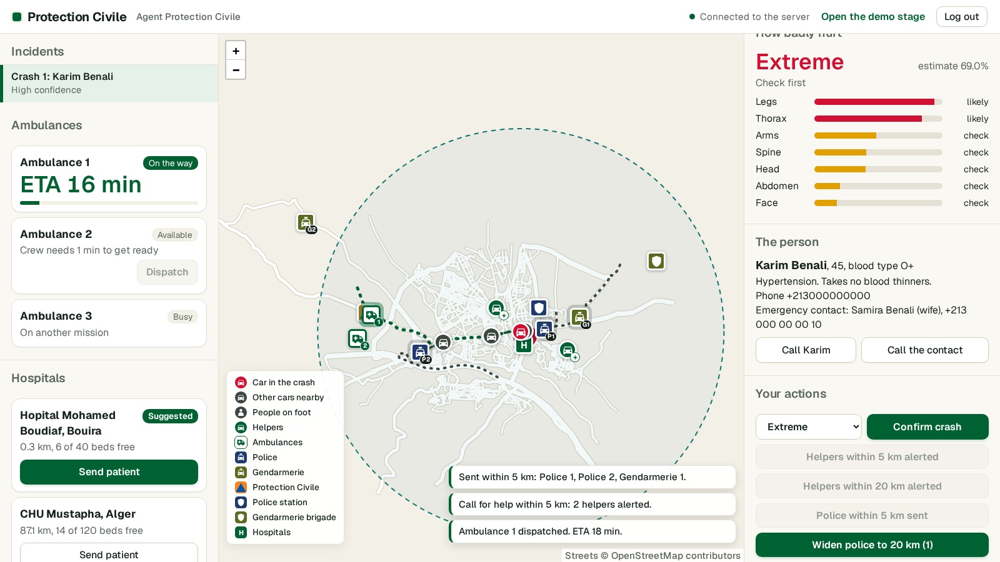
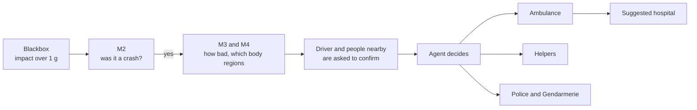
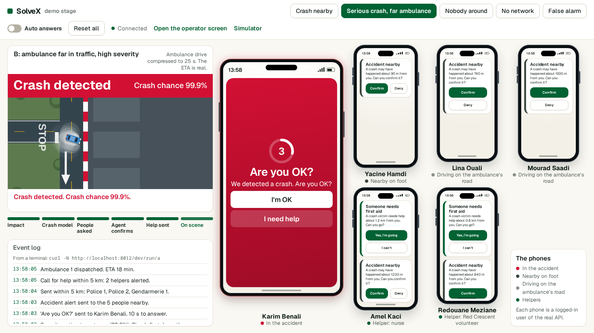
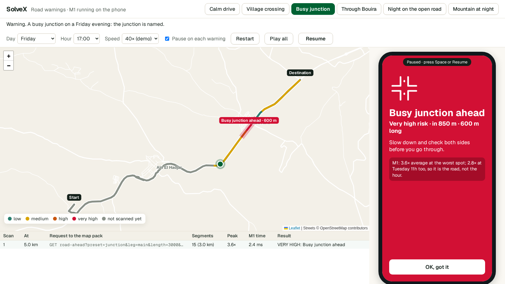

# SolveX 3.0 · Crash response

When a car crashes in Algeria, minutes are lost finding it, judging how bad it is, passing that on, and choosing a hospital. SolveX detects the crash automatically from an in-car **blackbox**, estimates who is hurt and how badly, and puts that picture in front of a Protection Civile agent, who stays in charge of every decision. It keeps working when the network is weak or gone.



## How it works



- **Detect.** The blackbox streams telemetry. A trigger makes M2 read the 8 s before and the 8 s after it.
- **Assess.** M3 estimates severity and M4 which body regions to check first, using the victim's profile if there is one.
- **Confirm.** The driver gets "Are you OK?" and people nearby are asked what they saw. Once someone answers, the others get "Accident nearby, be careful" instead, to help avoid a second crash.
- **Respond.** The agent sends an ambulance, calls first-aid helpers within 5 or 20 km, sends police and Gendarmerie units, and chooses a hospital from a ranked list. The ambulance then drives the patient there, and the hospital sees them coming.
- **No network.** Before entering a dead zone, the driver says when they will be back. If they aren't, the contact and the Gendarmerie are warned and help goes to the last known position.
- **Before the crash.** M1 runs on the phone and warns about dangerous road ahead.

## Run the demo

```bash
pip install -r requirements.txt    # Python 3.12
python download_models.py          # the weights: see the note below
python -m backend.main             # http://localhost:8000
```

The Hugging Face repo with the weights is private for now, so run `hf auth login` first, or set `HF_TOKEN`.

Open two windows side by side:

| Address | What it is |
|---|---|
| `localhost:8000/` | **Operator screen**. The login is prefilled (`+213000000100`, password `demo`). |
| `localhost:8000/dev` | **Demo stage**: the crash, the pipeline, the event log, and six phones that play everyone else. |

Press a scenario on the demo stage, then act on the operator screen. Everything works offline, and everyone in the demo is made up. The script is in [backend/DEMO.md](backend/DEMO.md).

| Scenario | What it shows |
|---|---|
| Crash nearby | Ambulance close, medium severity |
| Serious crash, far ambulance | Extreme severity, heavy traffic: a helper gets there first |
| Nobody around | A remote road with no witnesses |
| No network | The dead-zone check-in and the overdue alarm |
| False alarm | Hard braking: the trigger fires, M2 says no crash, nobody is disturbed |



Run **Reset all** between runs. In demo mode it deletes incidents, so never point the demo at real data.

### Other things to try

```bash
curl -N http://localhost:8000/blackbox/blackbox-01/crash    # a blackbox from any PC, as a second incident
python warn/app.py                                          # M1 road warnings, on http://localhost:8001
```

| Address | What it is |
|---|---|
| `localhost:8000/docs` | The API, from OpenAPI |
| `localhost:8000/dev/simulator` | Three cars streaming telemetry from the browser |
| `localhost:8000/dev/live` | A `curl` blackbox as an animation next to its detection panel |
| `localhost:8000/dev/monitor` | Each car's status and the 8 s countdown |



## The four models

| | Question | Output | Runs on | Trained on | Test score |
|---|---|---|---|---|---|
| **M1** | Is the road ahead dangerous? | low to very high | phone | French accidents (BAAC) | AUC 0.800 |
| **M2** | Was that a crash? | none, possible, likely, crash | server | US commercial fleets (VZCrash) | AP 0.990 |
| **M3** | How badly hurt? | low to extreme | server | US crash investigations (CISS, NASS) | AUC 0.889 |
| **M4** | Which body regions? | unlikely, check, likely, per region | server | the same | mean AUC 0.827 |

AUC and AP are ranking scores, not the share of cases a model gets right: 0.889 doesn't mean 89% accurate. None of the models has been tested on Algerian roads, which is why a person always decides and why missed cases have other ways in: the check-in, the SOS buttons, witnesses and a phone call. One crash goes through M2, M3 and M4 in about 8 ms on one laptop CPU core. Inputs, thresholds and limits are in [MODEL_SPEC.md](MODEL_SPEC.md).

## What is built, and what isn't

**Working now:** the full backend with accounts and roles, telemetry, M2, M3 and M4, incidents, notifications, ambulances, helpers, police and Gendarmerie, dead-zone check-ins, hospital ranking and transport, the operator screen, and the demo.

**Stubs and simulations:** push and SMS only log what they would send, phone calls are a mock, and the vehicles are moved by the simulation. Each scenario's severity comes from a real CISS case, not from the replayed recording.

**Still to do:**
- M1: fix the missing-data flaw, and build the OpenStreetMap and weather lookups for live use
- `crash_summary()`: fix ΔV underestimates and the `multi_impact` threshold
- Phone-side crash detection, and the confidence ladder that combines all signals
- The profile rule (pregnancy, heart disease and blood thinners raise M3 by one level)
- Hospital and police pages, and Postgres (the backend has only run on SQLite)

## Repository

```
backend/    FastAPI + Socket.IO: rules, models, tests. sim/ is the demo, web/ the pages
warn/       the M1 road warning demo, with its own server
m1/ ... m4/ training notebooks and dataset builders for each model
archive/    early notes and the first version of the plan
```

Weights (`m*/models/`) and data (`m*/data/`, `m*/raw/`) aren't in git.

| Read this | For |
|---|---|
| [PROJECT.md](PROJECT.md) | The concept, the Algerian context, the brief, suggestions |
| [MODEL_SPEC.md](MODEL_SPEC.md) | Each model's inputs, outputs, data and scores, with code to run them |
| [backend/README.md](backend/README.md) | The backend's layout, rules and settings |
| [backend/API.md](backend/API.md) | The API, for the app developer |
| [backend/PROTOCOL.md](backend/PROTOCOL.md) | The blackbox's telemetry messages |
| [backend/DEMO.md](backend/DEMO.md) | The demo script, step by step |
| [warn/README.md](warn/README.md) | How the road warnings work |

The weights are on [Hugging Face](https://huggingface.co/ZenoAbderrahim/solvex-crash-models).

## Tests

```bash
pytest                                               # 90 tests, about 15 s, with the real models and a temporary database
```

The parity checks in [backend/tests/parity/](backend/tests/parity/README.md) drive a running copy of the demo in a real browser. Run them on their own port and database, because they reset the demo.

## Retraining

<details>
<summary>How to retrain each model</summary>

**M1 (needs the Kaggle datasets):** [training table with weather](https://www.kaggle.com/datasets/moussaballou/training-table-weather-csv) · [accidents 2016–2024](https://www.kaggle.com/datasets/moussaballou/accidents-2016-2024-csv). Put `training_table_weather.csv` in `m1/data/` and run `m1/train_m1.ipynb`.

**M3 and M4 (CPU):** run `python download_models.py --data`, then the notebooks. To rebuild the tables from the raw NHTSA files, use `build_m3_dataset.py` and `build_m4_dataset.py`.

**M2 (Kaggle GPU):**
1. Accept the [VZCrash](https://huggingface.co/datasets/vzc-research-chapter/VZCrash) terms on Hugging Face and create a read token.
2. Import `m2/train_m2_kaggle.ipynb` into Kaggle. Add-ons → Secrets → add `HF_TOKEN`. Settings → GPU T4 (not P100), Internet on.
3. Run up to **Preflight checks**, then Save Version → Save & Run All.
4. Download `m2_models.zip` and unzip it into `m2/models/`.

If you edit `m2/m2_blackbox.py`, run `python m2/build_m2_notebook.py` to put the change into the notebook.

</details>

## Data and licenses

- **M1:** French BAAC road accident data (ONISR, data.gouv.fr)
- **M2:** [VZCrash](https://arxiv.org/abs/2606.06074), CC BY-NC 4.0, so the M2 weights are non-commercial
- **M3, M4:** NHTSA [CISS](https://www.nhtsa.gov/crash-data-systems/crash-investigation-sampling-system) and [NASS](https://www.nhtsa.gov/crash-data-systems/national-automotive-sampling-system)
- **M3 paper reference:** [Serious injury prediction with trainable B-splines (2026)](https://pubmed.ncbi.nlm.nih.gov/42102299/)
- **Map:** street data © OpenStreetMap contributors (ODbL). **Fonts:** Geist (SIL Open Font License)
